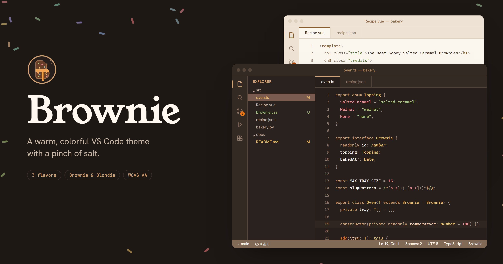
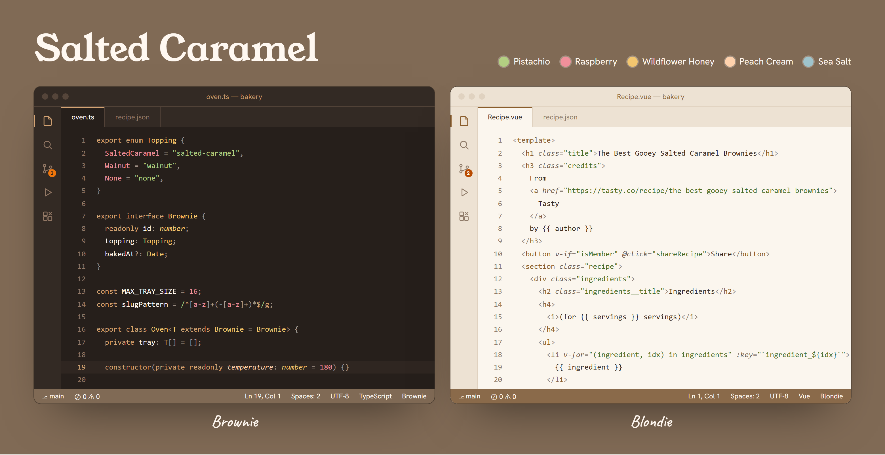
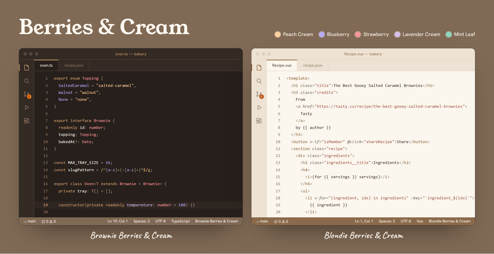
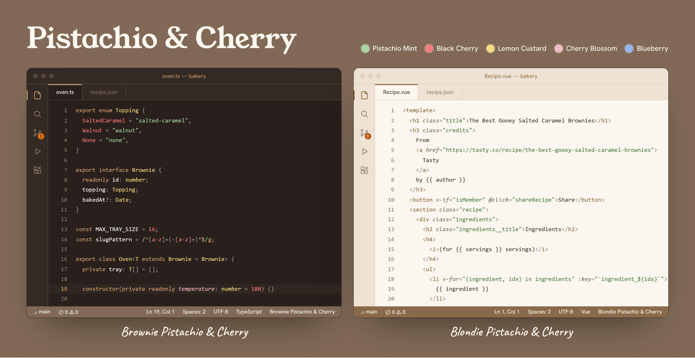
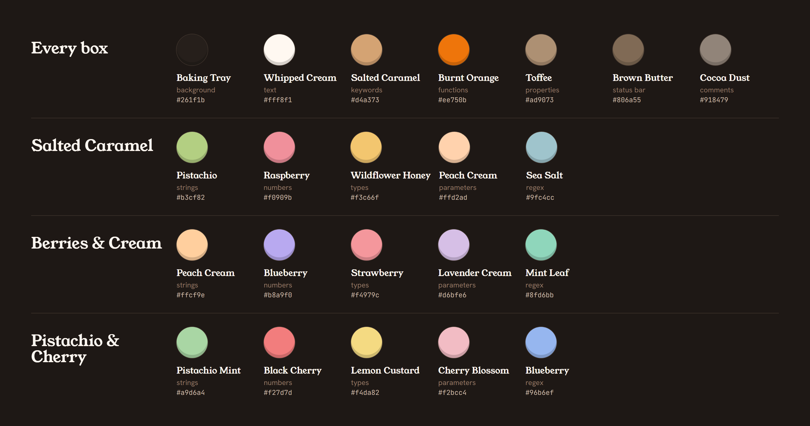

<p align="center">
  <a href="https://gregadro.github.io/brownie-theme/"></a>
</p>

# Brownie

A warm, colorful VS Code theme with a pinch of salt.

I made Brownie in 2022 for my own Vue work. The idea was simple: writing code should feel as good as eating a salted caramel brownie. Warm, soft on the eyes, a little sweet. Caramel keywords and burnt orange functions sit on a calm milk chocolate tray, and a few sweet colors are sprinkled on top.

In 2026 it got a proper re-bake. There are now three flavors, and each one comes as a dark **Brownie** and a light **Blondie**.

**[Take a look at the bakery →](https://gregadro.github.io/brownie-theme/)**

## Flavors

Every flavor shares the same base: the milk chocolate `#261f1b` tray, whipped cream text, caramel keywords, burnt orange functions and the brown butter status bar. Only the sprinkles change.

### Salted Caramel

The original recipe, and the one you get when you pick plain **Brownie** or **Blondie**. Pistachio strings, raspberry numbers, wildflower honey for types and a pinch of sea salt on every regular expression.



### Berries & Cream

Closest to the 2022 bake: strings stay peach cream, with blueberry numbers, strawberry types and a sprig of mint.



### Pistachio & Cherry

The brightest box in the shop. Pistachio mint, black cherry, lemon custard and a few blueberries.



## Ingredients



Every syntax color reaches at least 4.5:1 contrast against the background, in all six themes. The build also measures how far apart the colors are and refuses to bake if two of them look too alike, so keywords, functions and properties never melt into one orange blur.

## Install

1. Search for **Brownie** in the Extensions view (<kbd>Ctrl</kbd>+<kbd>Shift</kbd>+<kbd>X</kbd>), or run
   `code --install-extension gregadro.brownie`.
2. Open the theme picker with <kbd>Ctrl</kbd>+<kbd>K</kbd> <kbd>Ctrl</kbd>+<kbd>T</kbd> (<kbd>⌘</kbd>+<kbd>K</kbd> <kbd>⌘</kbd>+<kbd>T</kbd> on a Mac) and type _Brownie_ or _Blondie_.

| Flavor             | Dark                         | Light                        |
| ------------------ | ---------------------------- | ---------------------------- |
| Salted Caramel     | `Brownie`                    | `Blondie`                    |
| Berries & Cream    | `Brownie Berries & Cream`    | `Blondie Berries & Cream`    |
| Pistachio & Cherry | `Brownie Pistachio & Cherry` | `Blondie Pistachio & Cherry` |

Brownie at night, Blondie by day:

```jsonc
{
  "window.autoDetectColorScheme": true,
  "workbench.preferredDarkColorTheme": "Brownie",
  "workbench.preferredLightColorTheme": "Blondie"
}
```

## Make it your own

You can change any color without forking the theme:

```jsonc
{
  "workbench.colorCustomizations": {
    "[Brownie]": { "statusBar.background": "#6b2400" }
  },
  "editor.tokenColorCustomizations": {
    "[Brownie]": { "comments": "#a08f80" }
  }
}
```

## Baking it yourself

All six themes are generated from one palette, so edit the recipe, not the JSON:

- [`src/palette.js`](src/palette.js) holds every color and its name.
- [`src/build.js`](src/build.js) maps them to VS Code and checks contrast and distinctness.
- [`scripts/docs/`](scripts/docs/) renders the images above and the [landing page](https://gregadro.github.io/brownie-theme/) from the real themes.

```sh
npm install
npm run build   # themes/*.json
npm run docs    # docs/index.html and docs/images/*.png
```

Press <kbd>F5</kbd> to try your changes in a new VS Code window and open the files in [`examples/`](examples/). Issues and pull requests are very welcome.

## Thank you

If Brownie makes your editor a little cozier, you can buy me a coffee. It goes straight into my home barista hobby. ☕

[](https://www.buymeacoffee.com/gregadro)

[MIT](LICENSE.md) · [Changelog](CHANGELOG.md)
